<!-- Generated from src/docs/repository-readme.md by src/tools/refresh_latest.py. -->

> **Renatka 2.2.1** — a ClioPlay build for a Renault Scénic III with the
> physical armrest console. Start with [RENATKA.md](https://github.com/bobczan/Renatka/blob/main/RENATKA.md);
> the full change history and porting notes are in
> [CHANGELOG-RENATKA.md](https://github.com/bobczan/Renatka/blob/main/CHANGELOG-RENATKA.md).
>
> The previous 1.x-era tree is kept on the
> [`legacy-1.x`](https://github.com/bobczan/Renatka/tree/legacy-1.x) branch and tag.

<h1 align="center">Renatka</h1>

Offline navigation and Bluetooth audio for the Carminat TomTom, with working Scénic III console controls.

<a href="#install">Install</a> · <a href="https://pxwel-dev.github.io/ClioPlay-Send/">Send a destination from your phone</a>

## Version

| | |
| --- | --- |
| Renatka | **2.2.1** |
| Upstream | [`pxwel-dev/ClioPlay`](https://github.com/pxwel-dev/ClioPlay) `7a962e2` (ClioPlay 2.0.0) |
| Fallback | `v2.2.0` is proven on the car; `v2.1.1`, `v2.1.0` and `v2.0.0` are also tagged |
| Releases | `2.2.1` current · `2.2.0` proven · `2.1.1` packaging fix · `2.1.0` upstream merge · `2.0.0` first 2.0 · `legacy-1.x` the old 1.x tree |
| History | [CHANGELOG-RENATKA.md](https://github.com/bobczan/Renatka/blob/main/CHANGELOG-RENATKA.md) — every change, the hardware facts behind them, and a porting recipe for the next upstream release |

## What Renatka changes

- **The physical armrest console works out of the box** — nine buttons, joystick,
  rotary knob and knob press, read straight from `vehicledaemon`'s `RCswPipe`
  FIFO. No helper daemon, no `/dev/uinput`, no extra binary.
- **Speed in the bottom-right**, with a round UK speed-limit sign to its left
  and no `--` placeholder when the limit is unknown.
- **Manual zoom to Z10**, two steps deeper than upstream, persisted across
  reboots.
- **Road colours tuned** for legibility in both day and night themes.
- **Release identifier** at the bottom of Settings.
- Everything from ClioPlay 2.0: offline OSM maps, CPR2 routing, cameras,
  Bluetooth audio, phone destination transfer, 18 languages, frosted-glass HUD.

## UI previews

Rendered by this build's own C renderer at 480x272 from real map data, not
mock-ups. Day and night use the same production draw code as the head unit.

| Day | Night |
| --- | --- |
| 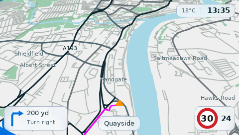 | 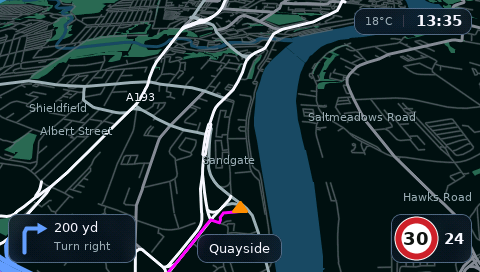 |

| Main menu | Trip itinerary |
| --- | --- |
| 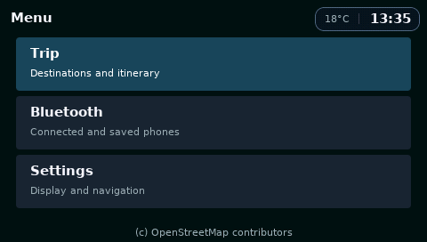 | 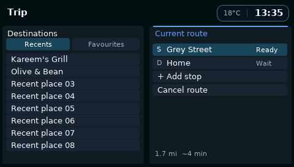 |

| Explore the map | Settings (release shown at the bottom) |
| --- | --- |
| 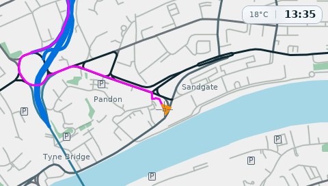 | 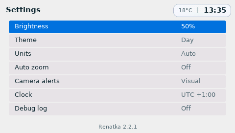 |

| Phone connection | Naming a favourite |
| --- | --- |
| 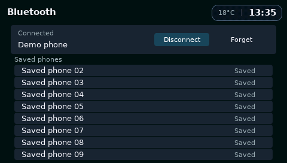 | 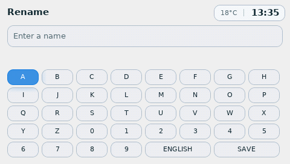 |

| Estimated speed limit (grey ring) | Volume notice |
| --- | --- |
| 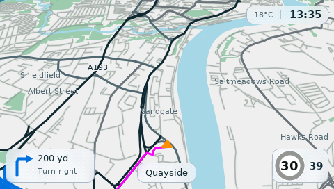 | 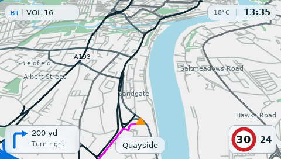 |

| Boot splash | Route overview |
| --- | --- |
| 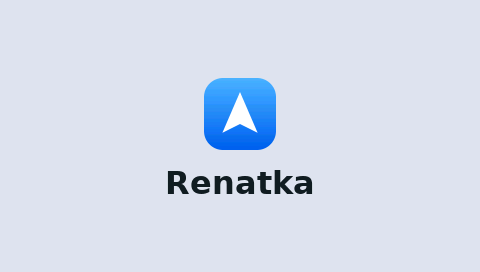 | 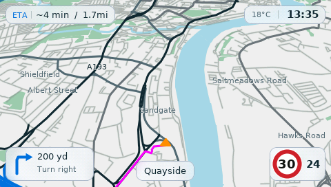 |

## Compatibility

The configuration this fork is built and tested for:

- Non-Bluetooth radio with a CD player
- Non-live Carminat TomTom head unit
- **Renault Scénic III / Mégane armrest console** — no Bluetooth remote needed

The console reader lives in `clio040` and is enabled by an empty `csw` file in
the SD-card root. It reads `vehicledaemon`'s `RCswPipe` FIFO directly; there is
no helper daemon and no `/dev/uinput`. An optional `cswmap.ini` can rebind any
control.

Vehicles that use the physical console still have the Carminat's integrated
Bluetooth hardware, so Bluetooth audio works the same way as on remote-equipped
cars.

ClioPlay handles the audio source as follows:

| Radio source read by ClioPlay | Source shown and used |
| --- | --- |
| CD / no-disc CD | **BT** |
| AUX | **AUX** |
| No valid live radio source | **BT**, independent of radio source/volume telemetry |
| FM / MW / LW | The reported radio source |

BT playback is available on CD and when no valid live radio source can be read;
BT CTRL also requires a connected phone. Unavailable radio/volume readings stay hidden.

## Features

- Offline OpenStreetMap navigation, routing and rerouting.
- Browse the map and route to a selected point, send destination from a connected phone, or manually enter named decimal-degree lat/long coordinates
- Manage stops, recents and favourites.
- Bluetooth phone audio with track information and remote playback controls.
- Steering wheel audio controls.
- Full-screen maps with animated, semi-transparent frosted glass notices for road names, camera alerts, route progress and audio changes.
- Day/Night themes with custom daily switch times in Auto, automatic units and time zones, and 18 interface languages.
- Mapped speed limits and camera alerts where the bundled country policy allows them.

For new stops/destinations, enter **Coordinates** on the head unit or use the separate [ClioPlay Send website](https://pxwel-dev.github.io/ClioPlay-Send/) to send the new route to ClioPlay from your phone via Bluetooth. For ease of use, add the website to your Home Screen as a web app.

## Install

You need an SD card for the head unit (minimum 8GB, ensuring that it’s already formatted to FAT32) and an `.osm.pbf` map extract covering your
journeys. Get the map extract from [Geofabrik Downloads](https://download.geofabrik.de/)
by choosing your region and downloading its `.osm.pbf` file. Download and extract
this repository, then follow your desktop setup:

| Computer | Start here |
| --- | --- |
| **Windows 10/11** | Follow [Windows setup](WINDOWS.md), then double-click **Install.cmd**. Uses Ubuntu 24.04 through WSL 2. |
| **macOS** | Install `python`, `osmium-tool`, `llvm` and `cabextract` with Homebrew, then open **Install.command**. |
| **Linux (Ubuntu 24.04)** | Install `python3 python3-venv python3-pip build-essential osmium-tool cabextract` with `apt`, then run `python3 install.py`. |

1. Choose your PBF and confirm its region.
2. Let the installer build and check navigation data.
3. Select the SD-card root and confirm installation.
4. Safely eject it before use and insert into your car. 

The installer downloads and checks the required official TomTom firmware.
It does not format the card. Replaced files are backed up. Any existing ClioPlay preferences,
pairings and saved places are preserved. No previous ClioPlay install is needed.
Map building can take substantial time for large extracts.

## Use your remote

| Control | Action |
| --- | --- |
| **MAP** | Restore Auto zoom after temporary manual zoom; otherwise switch between driving and map browsing, or return to driving from a menu. |
| **MENU** | Open the menu for Trip, Bluetooth and Settings. |
| **BACK** | Go back or dismiss a dialog. On the driving map with Bluetooth audio selected and a phone connected, toggle **BT CTRL**. |
| **Centre / OK** | On the driving map, show the ETA and remaining distance, or the heading without a route. In map browsing, select the point under the crosshair. In **BT CTRL**, play or pause. In menus, select or confirm. |
| **Up / Down** | Pan the map or move through menu rows. |
| **Left / Right** | Pan the map or change the selected tab, option or value. In **BT CTRL**, play the previous or next track. |
| **Left soft key** | Zoom out on the map, focus destinations in Trip, or delete a character while entering coordinates or a name. |
| **Right soft key** | Zoom in on the map, focus the itinerary in Trip, advance to the next coordinate field, or insert a space while entering a name. |

If you adjust the zoom while Auto zoom is enabled, **MAP** restores Auto zoom
without entering Explore. Press **MAP** again to enter Explore, or use an arrow
to enter Explore and pan directly. **OK** shows the ETA during guidance, including
while temporary Manual zoom is active.

See the [full remote controls guide](src/README.md#remote-controls) for actions in
each screen, including settings, pairing and the favourite keyboard.

## Use your console (Scénic III / Mégane)

On these cars the head unit is driven from the armrest, not a Bluetooth remote.
Renatka reads that console directly; nothing needs to be installed for it.

| Control | Action |
| --- | --- |
| **Top-left key** | Zoom out on the map, or delete a character while typing |
| **Back** | Go back / dismiss |
| **Top-right key** | Zoom in on the map, or advance to the next field |
| **Joystick up / down / left / right** | Pan the map, move through rows, change the selected value |
| **Knob rotate left / right** | Zoom the map, walk lists and dialogs |
| **Knob press** | OK — confirm, open, play/pause |
| **Menu** | Trip / Bluetooth / Settings |
| **Dest** | Menu (destination entry lives there) |
| **Map** | Toggle map browsing / return to driving |
| **Info** | ETA on the map |
| **Light**, **Repeat** | Not bound |

Controls are decoded from `vehicledaemon`'s FIFO by `clio040` and are enabled by
an empty `csw` file in the SD-card root. `cswmap.ini` can rebind any of them; see
[`cswmap.example.ini`](cswmap.example.ini).

## Status and development

Some legacy helper sources remain unavailable: see [source status](SOURCE_STATUS.md).
Original ClioPlay contributions use the [MIT licence](LICENSE); dependencies and
map data retain their [own licences and notices](THIRD_PARTY_NOTICES.md).
ClioPlay is independent of Renault and TomTom.

For development, see [contributing](CONTRIBUTING.md) and [building](src/BUILDING.md).

Firmware, map extracts, generated navigation, personal settings and build caches
are excluded from Git. The [UI previews](src/docs/demo/README.md) use the
production renderer with controlled host inputs; it does not establish vehicle performance.

Release files refreshed 13 November 2026 (Europe/London).
